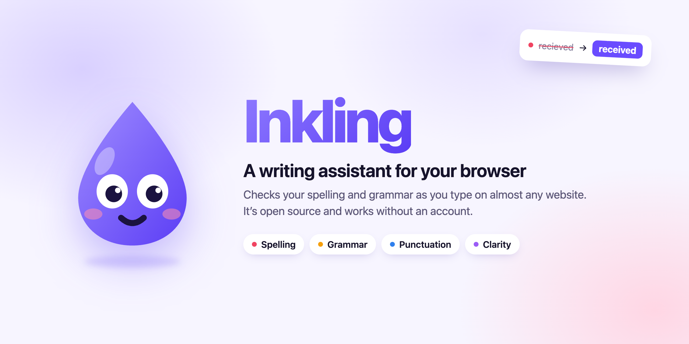
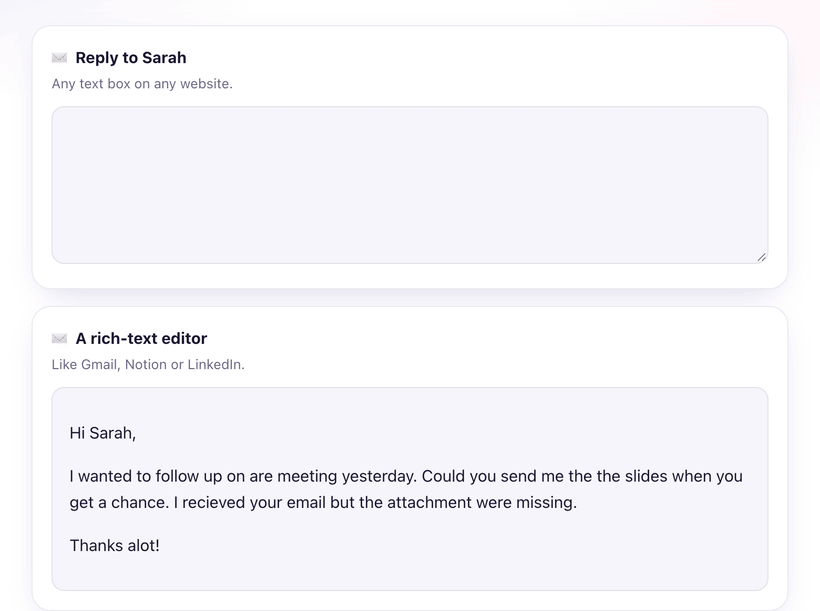
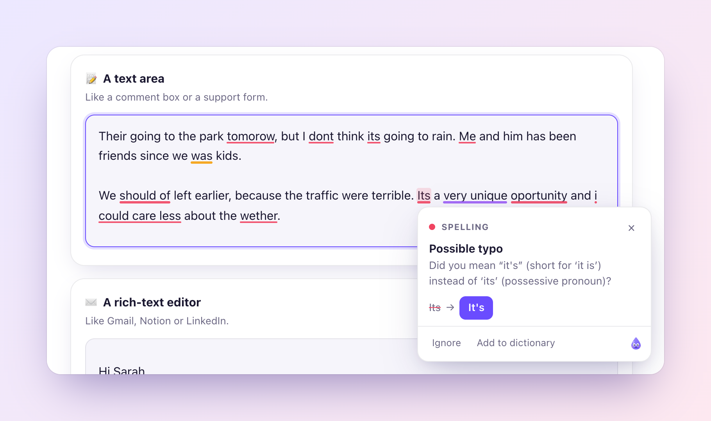
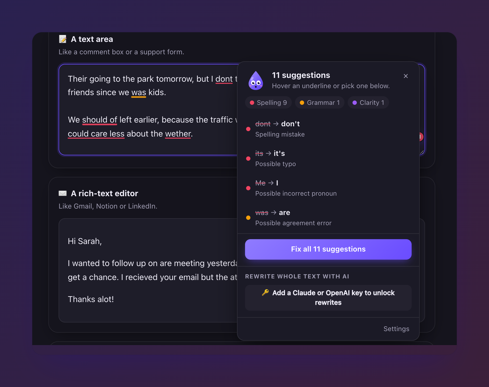
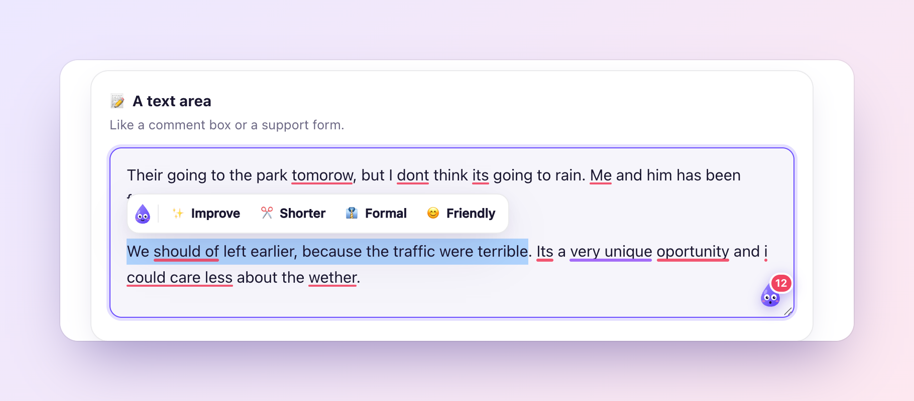
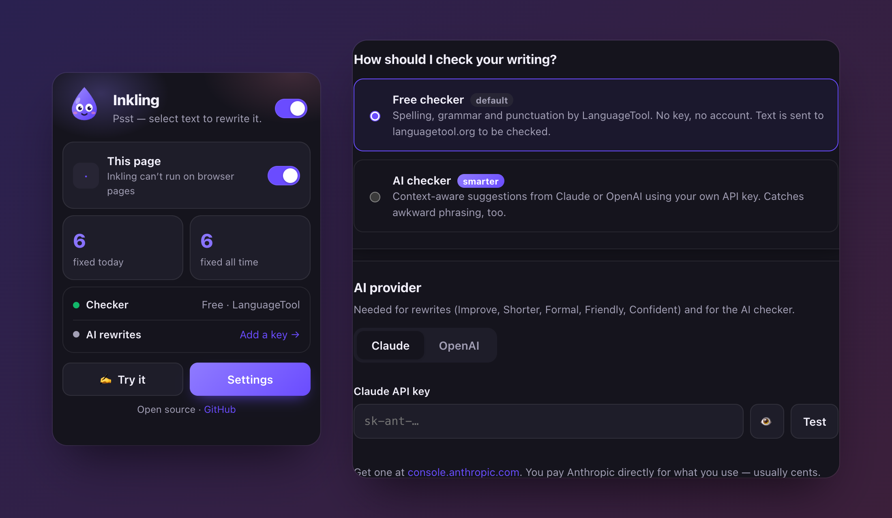
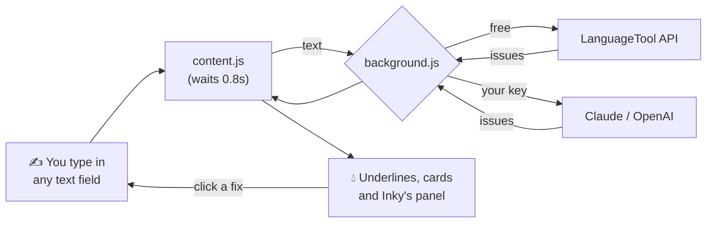
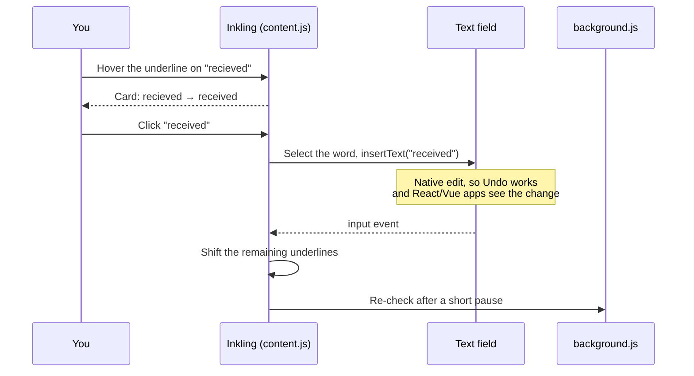

<div align="center">



<br />

[](LICENSE)
[](manifest.json)
[](#-install-in-60-seconds)
[](#-privacy)
[](#-project-structure)
[](#-contributing)

**Fix spelling, grammar and tone as you type — on any website.**<br />
Free. Private. No account. Bring your own AI for one-click rewrites.

### [🌐 Try the live demo →](https://inkling-writer.vercel.app)

[Install](#-install-in-60-seconds) · [Features](#-features) · [How it works](#-how-it-works) · [Privacy](#-privacy) · [FAQ](#-faq)

<br />



</div>

<br />

## ✨ Why Inkling?

Writing assistants are great — until they want an account, a subscription and every word you type on their servers. Inkling is the lightweight alternative:

|                                  | **Inkling**                | Typical paid assistant |
| :------------------------------- | :------------------------: | :--------------------: |
| Spelling, grammar, punctuation   | ✅                          | ✅                      |
| Rewrite: improve, shorten, tone  | ✅ with your own AI key     | ✅ paid plan            |
| Price                            | **Free** (AI: pay per use, cents) | Monthly subscription |
| Account required                 | **No**                     | Yes                    |
| Has its own server storing your text | **No**                 | Yes                    |
| Open source                      | **Yes, MIT**               | No                     |
| Install size                     | **~100 KB**, zero dependencies | Megabytes          |

<br />

## 🧩 Features

<table>
<tr>
<td width="50%" valign="top">

### 🖍️ Underlines as you type
Spelling, grammar, punctuation and clarity issues get a color-coded underline. Hover to see why, click to fix.



</td>
<td width="50%" valign="top">

### 💧 Meet Inky
Inky lives in the corner of the field you're typing in. Click it for every suggestion at once — and **Fix all** in one click.



</td>
</tr>
<tr>
<td width="50%" valign="top">

### ✍️ AI rewrites
Select any text and pick **Improve**, **Shorter**, **Formal**, **Friendly** or **Confident**. Powered by Claude or OpenAI with your own key.



</td>
<td width="50%" valign="top">

### ⚙️ Simple settings
Turn it off per site, pick your English variant, choose which checks you want and keep a personal dictionary.



</td>
</tr>
</table>

**Also:** works in text areas, text inputs and rich-text editors like the ones in Gmail, Notion and LinkedIn · light and dark mode · undo-friendly edits (<kbd>⌘</kbd>/<kbd>Ctrl</kbd> + <kbd>Z</kbd> works) · password fields are never read · <kbd>Esc</kbd> closes everything.

<br />

## 🚀 Install in 60 seconds

Inkling isn't in the Chrome Web Store yet, so you load it yourself. It takes a minute and you can read every line of code first.

**1. Get the code**

```bash
git clone https://github.com/STARMEXXX/inkling.git
```

…or click **Code → Download ZIP** above and unzip it.

**2. Load it into your browser**

| Browser | Open this page |
| :------ | :------------- |
| Chrome / Arc | `chrome://extensions` |
| Edge | `edge://extensions` |
| Brave | `brave://extensions` |

Turn on **Developer mode** (top right), click **Load unpacked**, and select the `inkling` folder.

**3. Pin Inky** 📌

Click the puzzle icon 🧩 in the toolbar and pin **Inkling**. A playground page opens so you can try it right away.

> [!TIP]
> To update later, run `git pull` (or download the ZIP again) and press the ↻ reload button on Inkling's card in `chrome://extensions`.

<br />

## 🤖 Unlock AI rewrites (optional)

Spelling and grammar checks work out of the box, for free. For rewrites and the smarter AI checker, add your own API key:

1. Get a key from [console.anthropic.com](https://console.anthropic.com/settings/keys) (Claude) or [platform.openai.com](https://platform.openai.com/api-keys) (OpenAI).
2. Click Inky in the toolbar → **Settings** → paste the key → **Test**.

| Model | Best for |
| :---- | :------- |
| `claude-opus-5-5` | Best quality (default) |
| `claude-sonnet-5-5` | Balanced speed and quality |
| `claude-haiku-5-5` | Fastest and cheapest — great for the AI checker |
| Any OpenAI chat model | Type its name in Settings (default `gpt-5-mini`) |

You pay the provider directly for what you use. A typical rewrite costs a fraction of a cent.

<br />

## 🔍 How it works



Inkling never changes the page's HTML to draw underlines. It mirrors the field's layout off-screen, measures where each word sits, and paints thin lines on its own transparent layer inside a [Shadow DOM](https://developer.mozilla.org/en-US/docs/Web/API/Web_components/Using_shadow_DOM). Your page's styles can't break Inkling, and Inkling can't break your page.

<details>
<summary><b>What happens when you click a fix</b></summary>

<br />



</details>

<details>
<summary><b>How the AI checker finds positions</b></summary>

<br />

The model returns plain JSON. Each issue quotes the exact text it wants to change, and Inkling finds that quote in your text:

```json
{
  "issues": [
    {
      "original": "recieved",
      "replacement": "received",
      "type": "spelling",
      "title": "Spelling",
      "message": "Common misspelling: i before e, except after c."
    }
  ]
}
```

Quotes it can't find are dropped. A hallucinated fix never lands in the wrong place.

</details>

<br />

## 🔒 Privacy

Inkling has **no server, no analytics and no account**. Your text goes only to the service you pick:

| What | Where it goes | When |
| :--- | :------------ | :--- |
| Text you type | `api.languagetool.org` | Free checker (default) |
| Text you type or select | `api.anthropic.com` or `api.openai.com` | Only if you add a key and use AI |
| Settings, dictionary | Your browser (`chrome.storage.sync`) | Always |
| API keys | Your browser only (`chrome.storage.local`, never synced) | When you save one |
| Password fields | Nowhere — never read | — |

Want zero network traffic on a site? Click Inky in the toolbar and switch that site off.

<br />

## 💧 Meet Inky

<p>
&nbsp;&nbsp;
&nbsp;&nbsp;
&nbsp;&nbsp;
&nbsp;&nbsp;

</p>

Inky's face tells you what's going on: **happy** when your text is clean, **thinking** while checking, **surprised** when it found something, **sad** if a check failed, and **asleep** when switched off.

<br />

## 📁 Project structure

```text
inkling/
├── manifest.json          # Extension manifest (MV3)
├── src/
│   ├── content.js         # Underlines, cards, Inky, selection toolbar
│   ├── background.js      # Message router (service worker)
│   └── engines.js         # LanguageTool, Claude and OpenAI clients
├── popup/                 # Toolbar popup
├── options/               # Settings page
├── playground/            # Try-it page that opens after install
├── ui/                    # Shared styles and the Inky SVG
├── icons/
└── site/                  # Landing page with a live demo (deployed on Vercel)
```

No build step, no `node_modules`. Edit a file, hit reload on `chrome://extensions`, done.

<br />

## ❓ FAQ

<details>
<summary><b>Does it work in Google Docs?</b></summary>
<br />
Not yet. Google Docs draws text on a canvas instead of using normal text fields, so Inkling can't see it. Sites built on normal text fields or rich-text editors (Gmail, Notion, LinkedIn, GitHub and most others) work. If a site misbehaves, please open an issue.
</details>

<details>
<summary><b>Which languages are supported?</b></summary>
<br />
English: American, British, Canadian, Australian, New Zealand and South African.
</details>

<details>
<summary><b>Is the free checker really free?</b></summary>
<br />
Yes. It uses LanguageTool's public API, which allows about 20 checks per minute. Inkling waits until you pause typing, so normal use stays well within that.
</details>

<details>
<summary><b>Why "Developer mode"? Is that safe?</b></summary>
<br />
Developer mode just lets Chrome load an extension from a folder instead of the Web Store. The code you load is exactly what's in this repo, and it's small enough to read in one sitting.
</details>

<br />

## 🤝 Contributing

Issues and pull requests are welcome. Good first ideas:

- 🌍 More languages
- 🎨 New Inky moods and animations
- 🧪 Support for more editors (CodeMirror, Monaco, canvas-based apps)

```bash
git clone https://github.com/STARMEXXX/inkling.git
# load the folder in chrome://extensions, then:
# edit → reload the extension → refresh the page
```

<br />

## 📄 License

[MIT](LICENSE). Use it, fork it, ship it.

<div align="center">
<br />

<br />
<sub>Made with ink and care.</sub>
</div>
